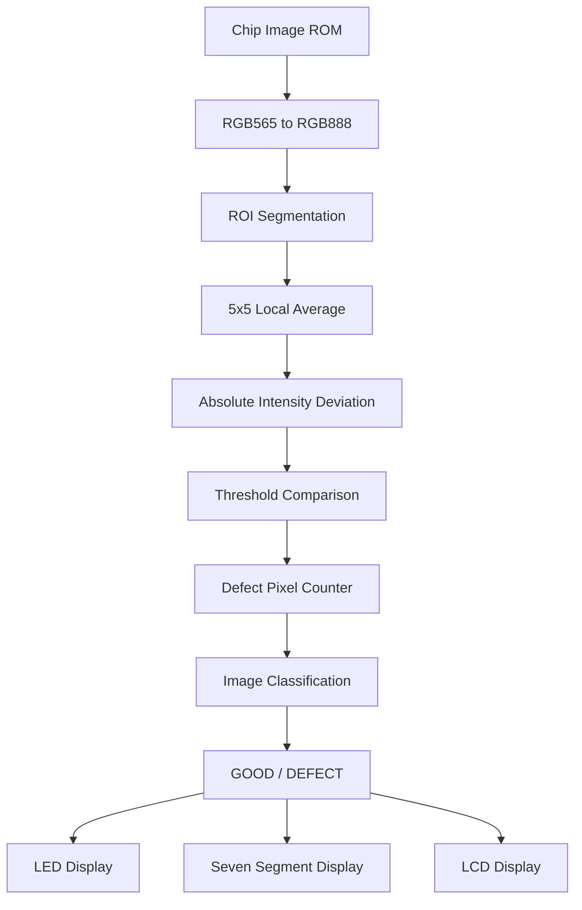

# FPGA-Faulty-Chip-Detection
FPGA-Based Faulty Chip Detection Using Verilog HDL on DE2-115
# FPGA-Based Faulty Chip Detection Using Verilog HDL

An FPGA-based image-processing system for detecting faulty semiconductor chips using local pixel-intensity analysis and defect-pixel counting.

## 1. Project Overview

This mini project implements a hardware-oriented faulty chip detection system using Verilog HDL on the **Terasic DE2-115 FPGA development board**.

The system processes pre-stored chip images, identifies abnormal pixel-intensity variations, counts potential defect pixels and classifies each image as either GOOD or DEFECT.

The design uses a pipelined 5 × 5 neighbourhood-based detection algorithm to compare each centre pixel with its local average intensity.

## 2. Objectives

- Implement image-based defect detection using Verilog HDL.
- Store and access chip images using FPGA ROM.
- Convert RGB565 pixel data into RGB888 format.
- Implement region-of-interest (ROI) segmentation.
- Perform local-average intensity analysis using a 5 × 5 window.
- Count defect pixels based on an intensity-deviation threshold.
- Classify images using a defect-pixel-count threshold.
- Display detection results using LEDs, seven-segment displays and an LCD.

## 3. Hardware and Software Requirements

| Component | Specification |
|---|---|
| FPGA Board | Terasic DE2-115 |
| FPGA | Altera Cyclone IV E |
| HDL | Verilog |
| Development Environment | Intel Quartus Prime |
| Simulation | ModelSim |
| Clock Frequency | 50 MHz |
| Image Resolution | 320 × 240 |
| Pixel Format | RGB565-shaped memory data |

## 4. System Architecture



## 5. Defect Detection Algorithm

The detector uses a 5 × 5 local neighbourhood around each eligible pixel.

**Step 1 – Local Average**

Calculate the average intensity of the 25 pixels in the neighbourhood.

**Step 2 – Intensity Deviation**

\[
D=|I_{\text{centre}}-I_{\text{average}}|
\]

**Step 3 – Pixel Classification**

A pixel is counted as a potential defect when:

\[
D>\Delta
\]

The configured deviation threshold is:

`DELTA = 10`

**Step 4 – Image Classification**

The total number of defect pixels is compared with the image-level threshold.

`COUNT_THRESHOLD = 360`

If the defect-pixel count is greater than 360, the image is classified as DEFECT. Otherwise, it is classified as GOOD.

## 6. Verilog Modules

| Module | Function |
|---|---|
| `top_sdram.v` | Top-level FPGA interface |
| `sdram_demo_core.v` | Main controller and image-processing integration |
| `rom_image_mem.v` | Chip image memory and pixel streaming |
| `rgb565_to_rgb888.v` | RGB format conversion |
| `roi_segmentation.v` | ROI selection |
| `defect_detector.v` | Local-average defect detection and pixel counting |
| `seg7_decoder.v` | Seven-segment decoding |
| `led_display.v` | LED output control |
| `lcd_display.v` | LCD output control |

## 7. Image Memory Files

The repository includes five Memory Initialization Files:

- `chip01.mif`
- `chip02.mif`
- `chip03.mif`
- `chip04.mif`
- `chip05.mif`

Each image memory is configured for 320 × 240 pixels (76,800 locations).

**Implementation note:** Verify the ROM initialization assignments in `rom_image_mem.v` before assuming that all five files are loaded as five distinct images.

## 8. FPGA Output Interface

The detection results are presented through:

- **Green LEDs:** GOOD image count and good classification indication.
- **Red LEDs:** DEFECT image count, total count and defect indication.
- **Seven-segment displays:** Numerical image counters.
- **16 × 2 LCD:** Total, good and defect counts with system status.

## 9. Pin Assignments and Constraints

The repository contains the DE2-115 board configuration files:

- `pin_assignments.tcl`
- `lcd_pins.tcl`
- `defect_detector.sdc`

These files define FPGA pin locations and timing constraints for the hardware implementation.

## 10. Simulation and Results

Simulation waveforms and hardware output photographs will be added after verification.

The following signals are important for simulation:

- Pixel input and valid signals
- Row and column coordinates
- ROI valid signal
- Defect pixel count
- Result valid signal
- GOOD / DEFECT classification
- Cumulative image counters

## 11. Future Improvements

- Implement more advanced image segmentation.
- Extend detection to all RGB colour channels.
- Introduce configurable ROI selection.
- Improve detection accuracy through adaptive thresholds.
- Evaluate the design using additional chip defect datasets.

## 12. Repository Structure

```text
FPGA-Faulty-Chip-Detection/
│
├── README.md
├── top_sdram.v
├── sdram_demo_core.v
├── rom_image_mem.v
├── defect_detector.v
├── rgb565_to_rgb888.v
├── roi_segmentation.v
├── seg7_decoder.v
├── led_display.v
├── lcd_display.v
│
├── chip01.mif
├── chip02.mif
├── chip03.mif
├── chip04.mif
├── chip05.mif
│
├── pin_assignments.tcl
├── lcd_pins.tcl
└── defect_detector.sdc
```

## 13. Author

**Nishant Paritosh**


## 14. Repository

[FPGA-Based Faulty Chip Detection – GitHub](https://github.com/paritoshnishant/FPGA-Faulty-Chip-Detection)

---

*This project was developed as a mini project to explore FPGA-based digital image processing and hardware implementation of chip defect detection.*
